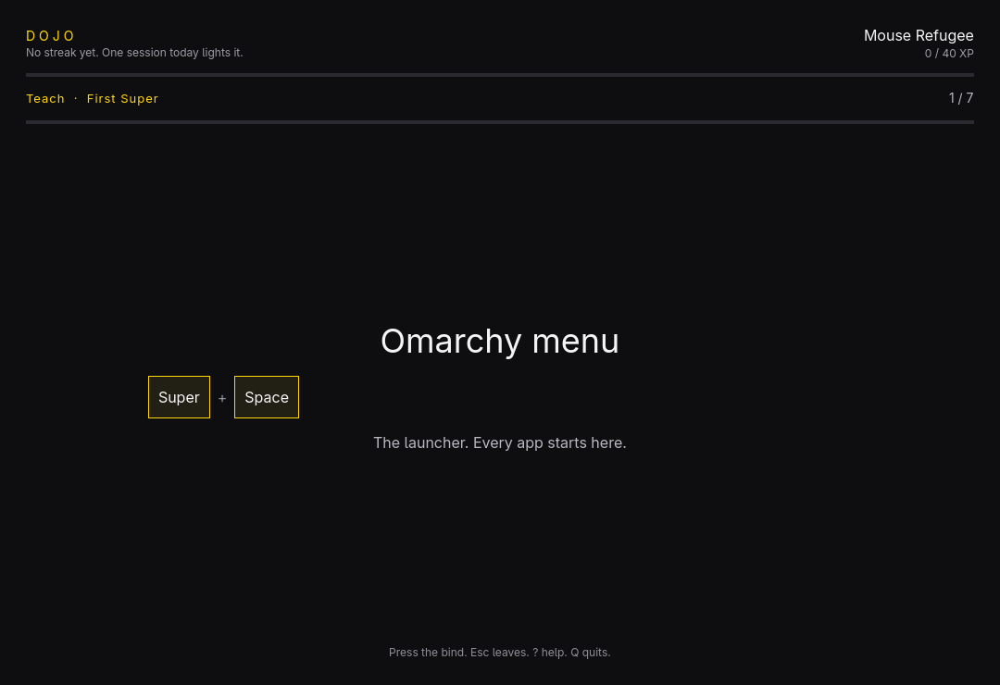

# Omarchy Dojo

Train the shortcuts on an Omarchy desktop. A belt is a short lesson, then a practice round where the keys hide. Clear it and the next belt opens. Sparring starts once the first belt is cleared.



The belts follow the live keybindings (`omarchy menu keybindings --print`): First Super, Windows, Workspaces, Focus, Capture, System, Everyday, and Signal. A belt with nothing to press is hidden. Teaching shows the keys and still asks for the real chord. Practice hides them, allows two tries, and opens the next belt at 70%. After that, Daily, Weak spots, Speed run, and Boss fight draw only from belts already cleared.

Progress stays in `$XDG_STATE_HOME/omarchy-dojo/state.json`, which is `~/.local/state/omarchy-dojo/state.json` when that variable is unset. An older Dojo file is kept and counted as experience.

## Install

From a checkout, on Arch:

```sh
./bin/install
```

That builds the package and installs the binary, the launcher entry, and the icon. Open **Omarchy Dojo** from the app launcher, or run `omarchy-dojo`.

## Shortcuts

| Key | Action |
| --- | --- |
| Space | Start the selected round, or continue from the result |
| Up / Down | Move through the belts |
| A | Open the atlas of every bind |
| Enter | Drill the atlas row under the cursor |
| H | Reveal a hidden bind during practice |
| Tab | Skip a practice card |
| Esc | Leave. In a round it asks first |
| Q | Quit. In a round it asks first |
| ? | Show or close this list |
| Super+Shift+Escape | Restore real shortcuts if a round gets stuck |

During a round the answer is the real shortcut. Space does not stand in for it.

## Check a desktop

`omarchy-dojo --check` prints one JSON line and exits 1 when the catalog cannot find the first belt. It does not open a window and does not grab the keyboard.

## Run from source

A C++ compiler, `make`, and Qt 6 (`qt6-base`, `qt6-declarative`, `qt6-wayland`) are enough. `qmake6` comes with `qt6-base`.

```sh
./bin/build
./bin/test
./build/omarchy-dojo
```

`./bin/test` builds the Qt Test binary and runs it offscreen. `omarchy-dojo --preview out.png` writes a screenshot without a display. `--lang da` renders that shot in Danish.

Visible strings are `qsTr()` and `tr()`, shipped as `src/i18n/<code>.json`. The app follows the language chosen under Omarchy's Setup > Language. Brand names, Super, and key names stay as they are.

## License

MIT. See [LICENSE](LICENSE).
